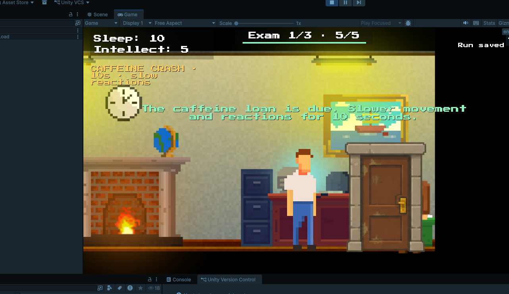
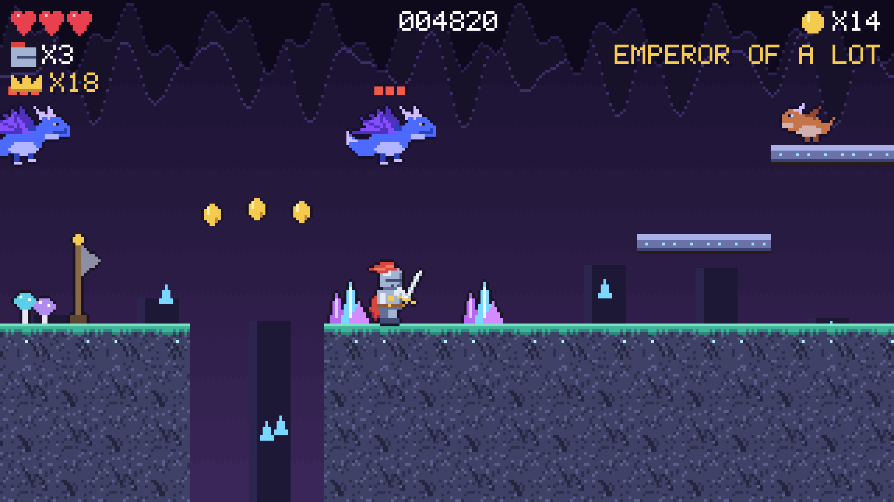

# Elizabeth Melnyk

Senior engineer and technical lead in Graz, Austria. I take products from the first idea to production: architecture, applied AI and agentic systems, C#/.NET and Unity.

## 🧰 Tech stack

## 🎮 Public projects

Most of my work is in closed-source and client projects, so my public repositories are a few small personal ones.

<table>
  <tr>
    <td width="320"></td>
    <td>
      <b><a href="https://github.com/weto4ka/StudentSurvival">Student Survival</a></b> 
      A team game about student life that started at a game jam. I updated my fork to Unity 6.3.
    </td>
  </tr>
  <tr>
    <td width="320"></td>
    <td>
      <b><a href="https://elzame.itch.io/knight-king">Knight King</a></b> 
      A retro-style knight game I built in Godot and published on itch.io. 
      ▶️ <a href="https://youtu.be/PfJGCVDgeIw">Watch on YouTube</a>
    </td>
  </tr>
</table>

Also: **[Now or Never](https://github.com/weto4ka/Now-or-Never-Games)**, a team game made for the SG Developer Program.

## 📫 More about me

- 🌐 **Webpage:** [lizamelnyk.com](https://www.lizamelnyk.com/)
- ✉️ **Contact:** contact@lizamelnyk.com
- 💼 **LinkedIn:** [elzamelnyk](https://www.linkedin.com/in/elzamelnyk/)
